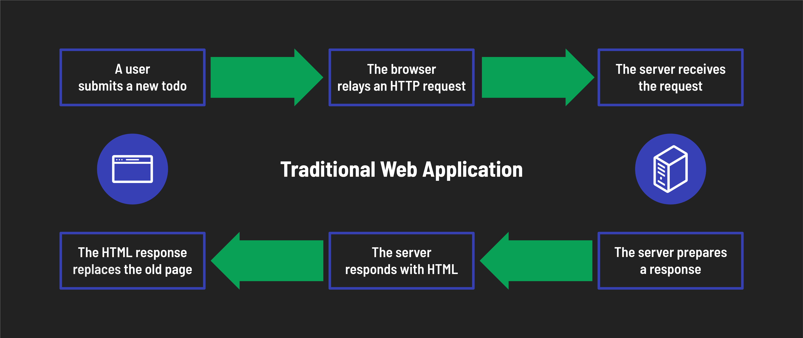
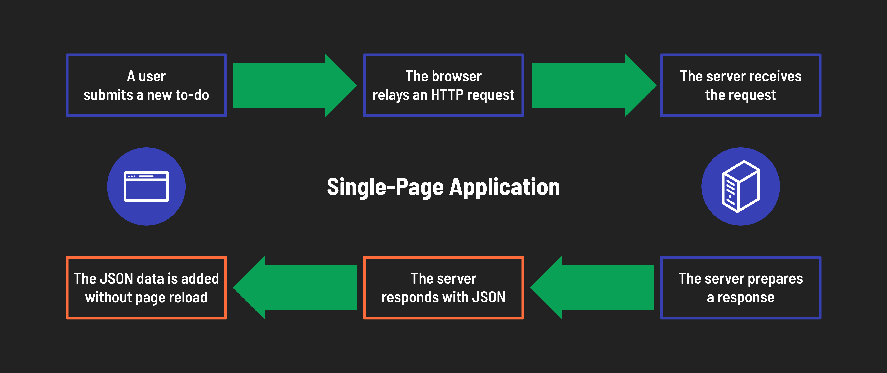
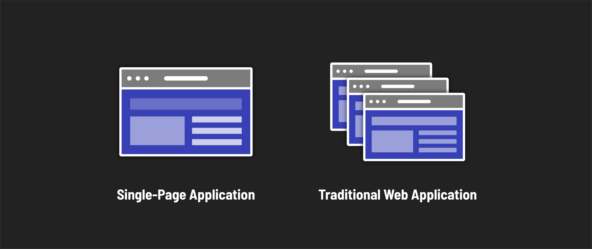

# 

**Learning objective:** By the end of this lesson, students will be able to discuss the difference between traditional web applications and single-page applications.

## Application Architecture

Before diving into what a Single-Page Application (SPA) is, let's take a step back and discuss how web applications are traditionally built. Traditionally, web applications were often implemented as multiple-page applications (MPAs). When a user navigates to a new page, clicks a link, or submits a form, the application sends a new HTML page to the browser. This was the standard way of building web applications for many years.

Let's take this into the real world for a minute. Think of a to-do application. In a traditional web application, when you add a new to-do item, the application sends a request to the server, and the server processes the request and sends back a new HTML page with the updated to-do list. This is how traditional web applications work.

This approach has some limitations. For example, it can be slow to load new pages, especially on slow internet connections. It also requires a lot of back-and-forth communication between the browser and the server, which can be inefficient. Overall, this could be a better user experience.

## Single-Page Applications Architecture

Single-Page Applications (SPAs) are a different approach to building web applications. In an SPA, the browser loads a single HTML page, and the application updates the page dynamically as the user interacts with it. This means that the user can navigate to different parts of the application without the need to load a new page from the server.

Going back to our to-do application example, in a SPA, when you add a new to-do item, we still send the request to the server, but instead of relying on the server to send back a new HTML page, the application updates the page dynamically to show the new to-do item. So, instead of reloading every item on the page, we just add or change what we need. This is a much faster and more efficient way of working.

SPAs have become increasingly popular in recent years; some of the most popular web applications are SPAs. For example, Google Maps, Gmail, and Facebook are all SPAs.

## Traditional Web Applications (Mulitple-Page Applications) vs Single-Page Applications

| Traditional Web Applications | Single-Page Applications |
| ---------------------------- | ------------------------ |
| Application sends new HTML page with each request | Application sends JSON with each request |
| Pages can be easily bookmarked and shared | Users navigate to a page through actions |
| Each page has its own url and HTML file | Application has a single url and HTML file |

There are some pros and cons to both approaches. Traditional web applications are more accessible to build and maintain but can be slow and inefficient. Single-page applications are faster and more efficient but can be more complex to develop and maintain.

> HTML and JSON are the most common formats for sending data from a server to a client; however, they are not the only formats. Many other formats exist, such as XML and CSV. The key takeaway is that a traditional web application sends a whole new page with each request, and a single-page application only sends the needed data, regardless of the format.